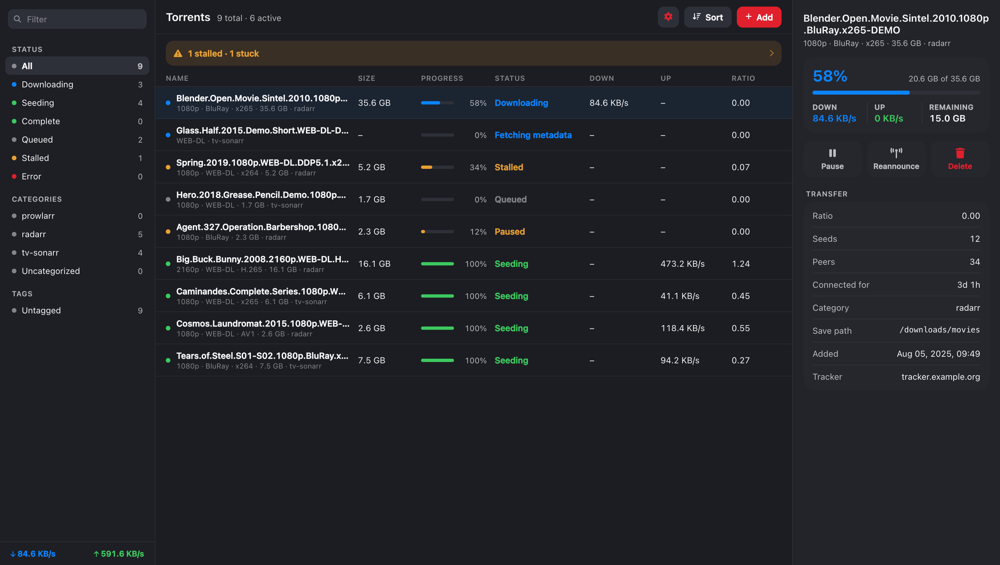
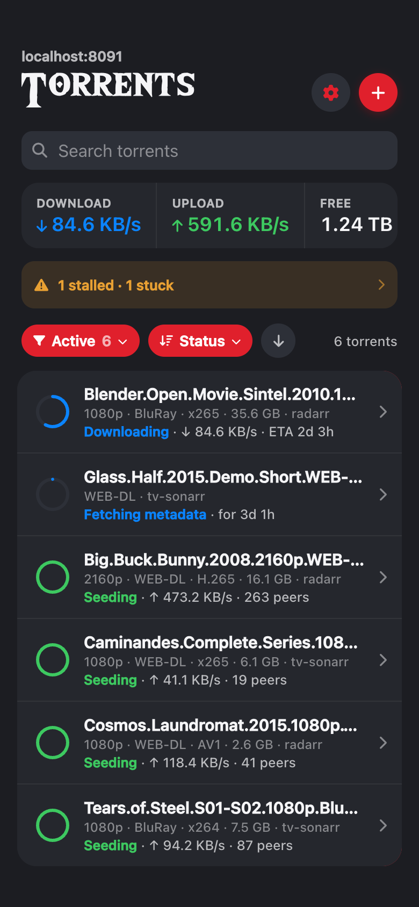
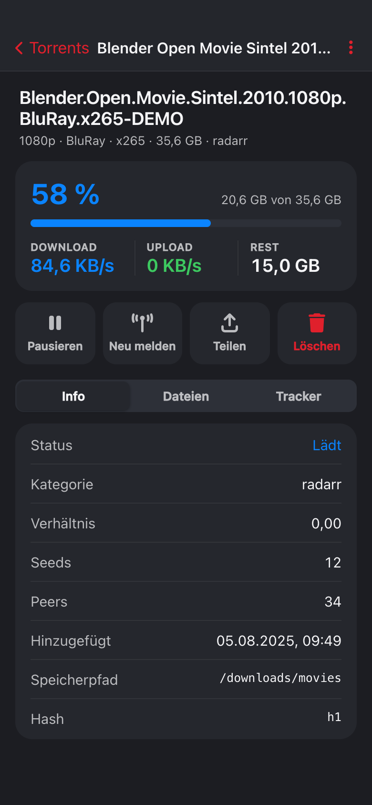
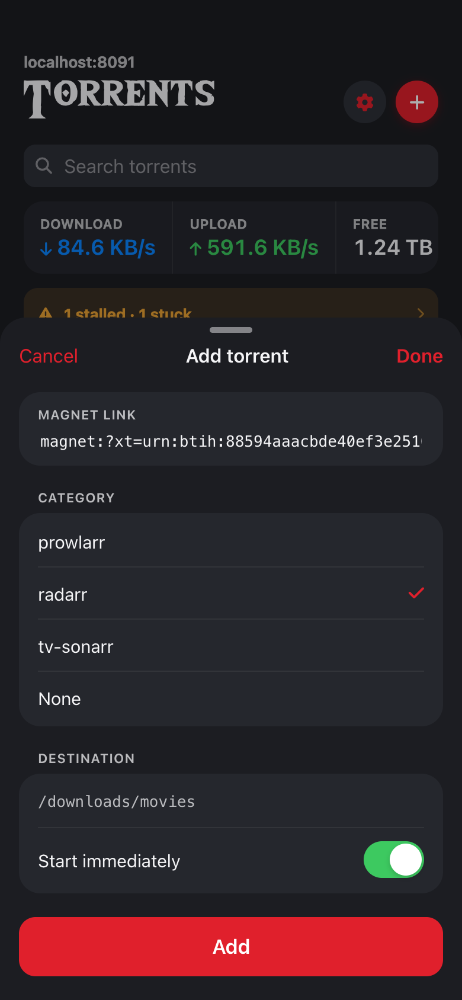
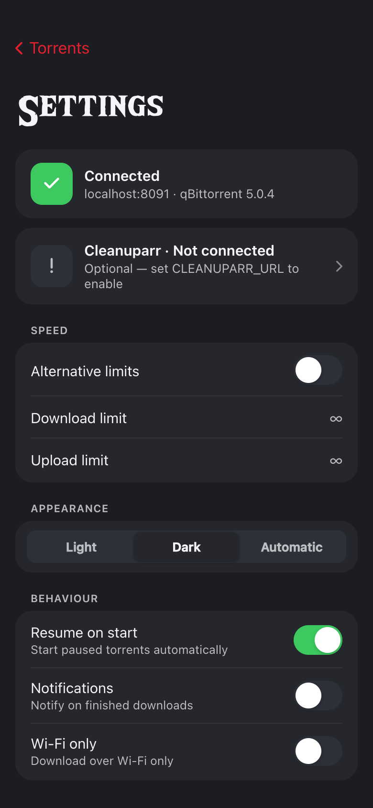

# qbit-ember

A hand-built, mobile-first web UI for [qBittorrent](https://www.qbittorrent.org/) — a
replacement for the stock WebUI. Dark theme with a red accent ("Modern Dark + Red"),
iOS-style navigation, and a desktop layout with sidebar + table + detail column.

Pure frontend: no backend of its own, no database. The app talks only to the official
[qBittorrent WebUI API v2](https://github.com/qbittorrent/qBittorrent/wiki/WebUI-API-(qBittorrent-4.1))
(`/api/v2/...`), mainly `sync/maindata` for delta polling on a 1.1s interval. Login goes
straight through your qBittorrent credentials.



| List | Detail | Add | Settings |
|---|---|---|---|
|  |  |  |  |

<sub>Screenshots use demo data (`tools/screenshot/`), not a real library.</sub>

## Features

- Torrent list with live search, filters, sorting and swipe actions (pause / delete)
- Detail view with progress, transfer stats, files and trackers
- Add torrents via magnet link, with category and derived save path
- Light / dark / automatic theme, installable as a PWA on iOS and Android
- Responsive: phone layout below 900px, three-column desktop above
- An attention line above the list that appears only when something needs you — errored,
  stalled or stuck torrents, low disk space, or a Cleanuparr that has gone quiet
- Torrents waiting on metadata are called out as such instead of posing as downloads

## Stack

- Angular (standalone components, signals), TypeScript strict
- Design tokens as CSS custom properties — light/dark, see [`design/`](design/README.md)
- Font Awesome 6 Free (CDN), WildBreath display font

## Local development

`proxy.conf.json` points at a real qBittorrent instance (same-origin trick, no CORS).
Change the target to your own instance:

```json
{ "/api": { "target": "http://qbittorrent.local:8080", "changeOrigin": true } }
```

```bash
npm ci
npx ng serve        # http://localhost:4200, /api/v2/* is proxied to your instance
```

## Build & Docker

A single self-contained container: multi-stage build (Node → nginx:alpine). nginx listens
on port **8091**, serves the static build and reverse-proxies `/api/v2/` to the backend
configured via `QBIT_API_URL` (default `http://gluetun:8080`, the standard qBittorrent
WebUI port). No CORS setup required.

```bash
docker build -t qbit-ember .
docker run -p 8091:8091 -e QBIT_API_URL=http://qbittorrent.local:8080 qbit-ember
```

On push to `main` (or on `v*` tags) GitHub Actions builds a multi-arch image
(`linux/arm64` + `linux/amd64`) and pushes it to GHCR, so low-powered hosts like a
Raspberry Pi never have to build it themselves.

## Cleanuparr (optional)

If you run [Cleanuparr](https://cleanuparr.github.io/Cleanuparr/), point the container at it and
settings shows whether the connection works (including a rejected API key), a dedicated
Cleanuparr screen carries the stats, and — matched on the torrent hash — a strike card appears
on the detail screen, so a stalled download tells you whether something is already handling it. Leave it unset and the app
behaves exactly as if the integration did not exist — nothing is shown, nothing is polled.

```yaml
    environment:
      - CLEANUPARR_URL=http://cleanuparr:11011
      - CLEANUPARR_API_KEY=<from Cleanuparr → account settings>
```

The API key is injected by nginx, so it never reaches the browser. The hostname is resolved per
request, which means an unreachable or unconfigured Cleanuparr answers 502 and the UI hides the
feature instead of nginx failing to start. Outside a Docker network, also set `DNS_RESOLVER` to a
reachable DNS server (default is Docker's embedded `127.0.0.11`).

## Deployment (docker compose / Komodo)

```yaml
services:
  qbit-ember:
    image: ghcr.io/dragonmasta37070/qbit-ember:latest
    container_name: qbit-ember
    environment:
      - QBIT_API_URL=http://gluetun:8080   # qBittorrent WebUI behind Gluetun
      # optional, see above — omit entirely if you don't run Cleanuparr
      # - CLEANUPARR_URL=http://cleanuparr:11011
      # - CLEANUPARR_API_KEY=...
    ports:
      - "8091:8091"
    networks:
      - gluetun-net          # same network as the gluetun container
    restart: unless-stopped
    # drop `ports` if an upstream reverse proxy (nginx) serves
    # qbit-ember:8091 on its own subdomain
```

Note: nginx resolves the `QBIT_API_URL` hostname at startup, so the `gluetun` container
has to be running before `qbit-ember` starts (`depends_on`, or stack order in Komodo).

## Design

The full high-fidelity design handoff (tokens, screens, style guide, interactive
prototypes) lives in [`design/`](design/README.md) and is the authoritative reference for
colours, components and behaviour — including for future changes.

## License

[MIT](LICENSE)
